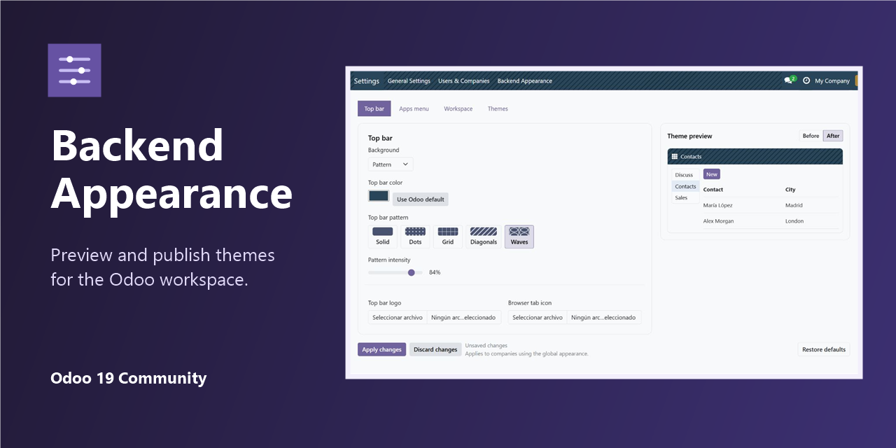

# Backend Appearance for Odoo 19

Visual settings for the internal Odoo client. See [Español](README.es.md).



[Appearance editor](euw_backend_appearance/static/description/editor.jpg) ·
[Apps menu](euw_backend_appearance/static/description/apps-menu.jpg) ·
[Theme library](euw_backend_appearance/static/description/themes.jpg)

## Install and verify

The technical module name is `euw_backend_appearance`. If you installed the earlier `backend_appearance` module, export the appearance profiles and themes you want to keep before uninstalling it. Then install the renamed module and import the JSON files. Odoo treats the renamed module as a separate installation. The published server test results predate the rename.

On a disposable Odoo 19 database, add the repository to the server's add-ons path, refresh the app list in developer mode and install **Backend Appearance**. Clear the Apps filter if needed. Open **Settings → Backend Appearance**.

The editor has four sections: **Top bar**, **Apps menu**, **Workspace** and **Themes**. Changes preview immediately in the current tab. You can open Contacts and then return to apply or discard the draft. Choose the global profile or the active company in the scope selector. Companies inherit the global profile until they have their own. Use **Use global appearance** to remove a company override.

In Top bar, switch between **Solid color**, **Pattern** and **Photo**. Photos have a vertical crop control. You can also upload a logo and a browser tab icon. Images accept PNG and JPEG up to 4 MB, and WebP when the server has a decoder.

Under **Themes**, save up to 20 named combinations and export or import version 1 JSON. Loading or importing a theme creates a draft until you select **Apply changes**.

On an existing Windows test installation, run `./start-test.ps1 -Update` from this repository. The script runs tests, prepares web assets and leaves the server running on port 18119.

To run the installation and automated tests against an isolated Docker database, open a terminal in this repository:

```sh
docker compose -p codex-odoo-appearance -f compose.test.yml run --rm odoo odoo -d appearance_test -i euw_backend_appearance --test-enable --test-tags /euw_backend_appearance --stop-after-init
```

The **Custom** style lets you pick the apps menu background and highlight. Text automatically switches between black and white according to each state's background.

For an existing disposable test server, retain its database connection and add-ons settings:

```sh
odoo -d appearance_test -i euw_backend_appearance --test-enable --test-tags /euw_backend_appearance --stop-after-init
```

For the manual acceptance test, install Contacts, Sales and Inventory. Create and edit a contact, save a quotation with a product and open an inventory list. Verify search and filters, regular-user access and narrow layouts. Upgrade the module, then uninstall it through Apps on the test database. Reload the client and reopen the records from the test. Check that the appearance returns to the Odoo baseline and that the published profile is removed.

Compatibility target: Odoo 19.0 Community. Fresh installation and server tests passed in isolated Docker with Contacts, Sales and Inventory. Full browser and uninstall validation are pending. License: LGPL-3.
